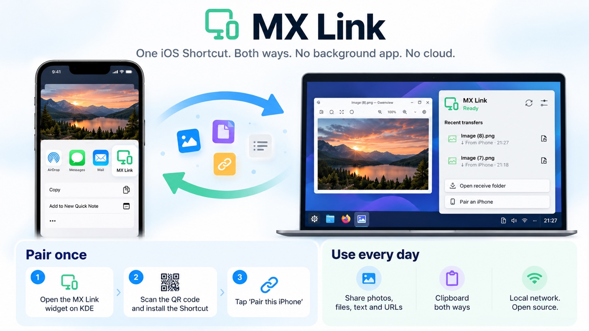

# MX Link

**Partagez photos, fichiers, textes et liens entre iPhone et KDE Plasma, sur votre réseau local.**

**Un seul raccourci iOS. Dans les deux sens. Aucune app en arrière-plan. Aucun cloud.**

[](mx-link-overview.png)

## Ce que fait MX Link

**iPhone → KDE**
- Partagez photos, PDF et fichiers depuis la feuille de partage iOS. Ils sont enregistrés sur KDE, avec ouverture automatique possible des photos et PDF.
- Partagez une URL : elle s'ouvre directement dans le navigateur du PC.
- Partagez du texte : il est copié dans le presse-papiers KDE.

**KDE → iPhone**
- Copiez un texte, une image ou des fichiers sur KDE.
- Lancez le raccourci **MX Link** sur l'iPhone et choisissez **Récupérer depuis MX**.

**Presse-papiers iPhone → KDE**
- Lancez le même raccourci et choisissez **Envoyer vers MX** pour transmettre le texte du presse-papiers.

**Tous les échanges sont déclenchés depuis l'iPhone.** Rien ne tourne en arrière-plan sur iOS et le presse-papiers n'est pas synchronisé automatiquement.

## Installation

Il faut KDE Plasma sur MX Linux ou une distribution basée sur Debian, un iPhone avec l'app Raccourcis et les deux appareils sur le même réseau local.

Sur KDE :

```bash
git clone https://github.com/Syl6931/mx-link.git
cd mx-link
bash install.sh
```

Ouvrez le widget **MX Link** dans le panneau Plasma, puis **Appairer un iPhone**. Scannez le QR code, installez le raccourci iOS et sélectionnez **Appairer cet iPhone** sur la page affichée.

C'est tout. Depuis l'iPhone, utilisez **Partager → MX Link** pour envoyer immédiatement un élément, ou lancez le raccourci **MX Link** seul pour choisir le sens du presse-papiers.

Les fichiers reçus arrivent par défaut dans **Téléchargements/MX Link**. Le widget Plasma affiche les échanges récents et les réglages de réception.

## Accès réseau local et sécurité

MX Link a besoin du **port TCP entrant 8767 sur l'ordinateur Linux** pour être accessible depuis l'iPhone. La passerelle écoute sur toutes les interfaces réseau (`0.0.0.0:8767`) ; le service interne n'écoute que sur `127.0.0.1:8765`. Aucune redirection de port sur la box ou le routeur n'est nécessaire : **ne redirigez pas TCP 8767 vers Internet**.

À l'installation, MX Link ajoute une règle UFW autorisant TCP 8767 **depuis le sous-réseau IPv4 local détecté sur l'interface de la route par défaut**. L'installateur **n'active pas UFW**. Cette règle ne restreint effectivement l'accès que si UFW est actif ; si vous utilisez un autre pare-feu, configurez-le séparément. Sur une machine avec plusieurs interfaces réseau, vérifiez quels réseaux peuvent accéder au port 8767.

**Utilisez MX Link uniquement sur un réseau local de confiance.** La page d'appairage `/setup` est accessible sans authentification et contient le jeton : toute personne pouvant consulter cette page peut récupérer ce jeton. Les autres requêtes de transfert exigent ce jeton, mais le trafic passe en **HTTP non chiffré**, pas en HTTPS. Évitez les Wi-Fi publics ou non fiables.

## Désinstallation

```bash
bash uninstall.sh
```

Pour supprimer aussi les paramètres d'appairage : `bash uninstall.sh --purge`. Les fichiers déjà reçus sont conservés.

[Read in English](README.md).
